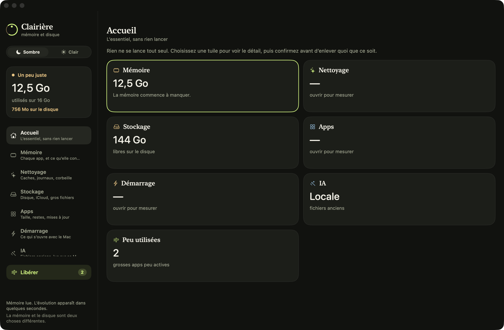
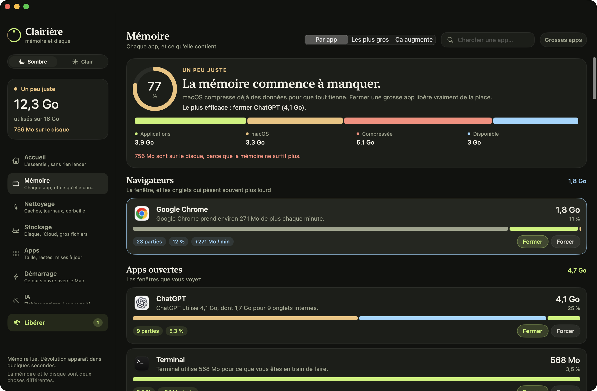
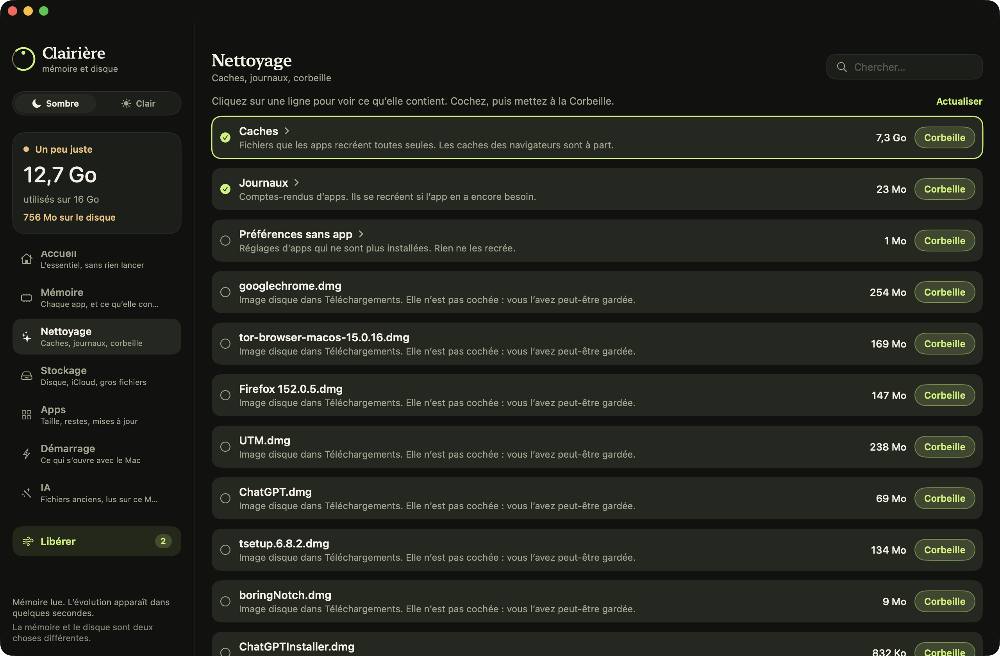
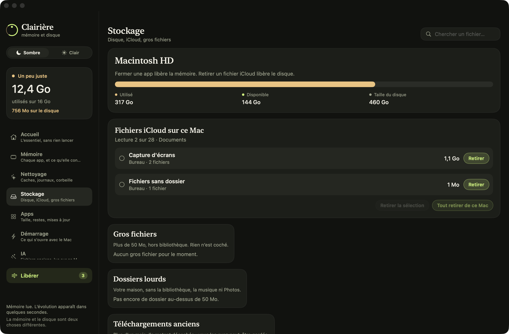

# Clairière

[](LICENSE)
[](LICENSE)
[](https://github.com/JSurquin/Clairiere/releases)

Clairière montre ce qui occupe la mémoire et le disque de votre Mac, puis vous laisse libérer de la place. Rien ne part sans une liste visible et votre accord. La mémoire et le disque sont traités comme deux choses différentes.

Le code est libre, en entier, sous [licence MIT](LICENSE) : l’utiliser, le modifier et le redistribuer est permis.

## Aperçu

Accueil. Les tuiles résument, sans lancer de gros calcul toutes seules.



Mémoire. Les apps sont rangées, avec ce qu’elles utilisent et les boutons Fermer et Forcer.



Nettoyage. Une ligne comme Caches s’ouvre pour montrer ce qu’elle contient. Rien ne part sans confirmation.



Stockage. La place du disque, et les copies locales iCloud que l’on peut retirer de ce Mac.



## Onglets

| Onglet | Ce que vous y faites |
| --- | --- |
| Accueil | L’essentiel, sans lancer de gros calcul tout seul |
| Mémoire | Chaque app, les plus gros, et ce qui augmente |
| Nettoyage | Caches, journaux, corbeille du Mac |
| Stockage | Place du disque, copie locale iCloud, gros fichiers, doublons |
| Apps | Taille, restes, remise à zéro, mises à jour |
| Démarrage | Ce qui s’ouvre avec le Mac, désactivable et remis en route |
| IA | Fichiers pas ouverts depuis longtemps, relus sur ce Mac |

Dans Mémoire, les apps sont rangées en Navigateurs, Apps ouvertes, En arrière-plan et macOS. Une app de la barre de menus, comme Ollama, est marquée comme telle : **Fermer** demande poliment, **Forcer** enlève aussi l’icône.

Le thème sombre est celui du départ. **Sombre / Clair**, sous le nom, change l’apparence. Le choix est gardé.

## Principes

- Une suppression passe par une liste, puis une confirmation.
- Quand c’est possible, les fichiers vont à la Corbeille. Vider la corbeille du Mac, ou supprimer un instantané Time Machine, est indiqué comme définitif.
- Retirer un fichier iCloud n’enlève que la copie sur ce Mac. Le fichier reste dans iCloud et se retélécharge à l’ouverture.
- Les éléments de macOS (Finder, Dock, launchd) restent marqués « laisser ouvert ».
- Clairière n’est pas un antivirus, et elle ne prétend pas réparer les permissions.

L’onglet IA installe et lance [Ollama](https://ollama.com) si besoin, avec un petit modèle local. Le tri s’appuie sur le nom, la date et la taille. Le contenu des fichiers n’est pas ouvert, et rien n’est envoyé ailleurs.

## Télécharger

Les versions prêtes à lancer sont sur [Releases](https://github.com/JSurquin/Clairiere/releases). Le fichier `Clairiere-macOS.zip` contient l’app pour Mac Apple silicon.

1. Ouvrez l’archive.
2. Glissez Clairière dans Applications.
3. Au premier lancement, clic droit sur l’app, puis **Ouvrir**.

La build publiée est signée localement. Apple ne l’a pas notariée, donc macOS demande cette confirmation une fois.

## Compiler

macOS 14 ou plus récent, et Swift 6. Xcode n’est pas nécessaire.

```bash
git clone https://github.com/JSurquin/Clairiere.git
cd Clairiere
./build.sh
open dist/Clairiere.app
```

`build.sh` dessine l’icône, compile en mode release, assemble `dist/Clairiere.app` et la signe localement.

## Publier une version

Le workflow [Release](.github/workflows/release.yml) compile l’app et la joint à une release GitHub.

Depuis l’onglet **Actions**, choisissez **Release**, puis **Run workflow**. Indiquez un numéro `1.2.3`. Le tag `v1.2.3` et le zip sont créés sur le commit de la branche choisie.

La même chose se produit si vous poussez un tag vous-même :

```bash
git tag v1.2.3
git push origin v1.2.3
```

## Clavier

| Raccourci | Action |
| --- | --- |
| ⌘1 à ⌘7 | Accueil, Mémoire, Nettoyage, Stockage, Apps, Démarrage, IA |
| ⌘F | Recherche de l’onglet |
| ↑ ↓ | Élément précédent ou suivant |
| Entrée | Ouvre le détail |
| Espace | Coche ou décoche |
| ⌘A / ⌘⇧A | Tout cocher / tout décocher |
| ⌘Retour | Action de la ligne |
| ⌘⇧Retour | Forcer la fermeture |
| ⌘O | Montrer dans le Finder |
| ⌘L | Libérer de la mémoire |
| Échap | Ferme le dialogue, le détail, puis la recherche |

## Licence

[MIT](LICENSE). Open source, libre complet.
